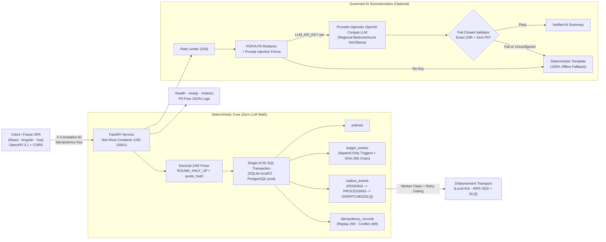

# Life Annuity Ledger Reference Architecture

[](https://github.com/uoion/life-annuity-ledger-ref/actions/workflows/ci.yml)


A cloud-native, containerized **ZAR Guaranteed Life Annuities** backend reference architecture demonstrating full-lifecycle engineering ownership for regulated South African financial services:

* **Deterministic Financial Core:** Exact `decimal.Decimal` (`ROUND_HALF_UP`) annuity pricing with SHA-256 `quote_hash` audit reproducibility — financial arithmetic is **never** delegated to an LLM.
* **Tamper-Evident Audit Ledger:** Append-only SQL ledger protected by both database-level immutability triggers (`UPDATE`/`DELETE` aborted) and a verifiable SHA-256 hash chain (`GET /api/v1/ledger/verify`).
* **Duplicate-Proof Event-Driven Disbursements:** Atomic policy issuance combining strict `Idempotency-Key` replay/conflict (`409`) handling, a transactional **Outbox Pattern** with `PENDING -> PROCESSING` row claiming, and automatic Dead-Letter Queue (`DEAD_LETTER`) routing.
* **POPIA & ISO/IEC 42001 Governed AI:** Outbound PII redaction (SA IDs, names/tokens, emails, phone numbers, bank accounts), prompt-injection fencing, provider-agnostic OpenAI-compatible HTTP config, and a **fail-closed output validator** that reverts to a deterministic template if an LLM is unconfigured, unreachable, alters a Rand figure, or echoes PII.
* **Production Hardening:** Multi-stage non-root Docker (`UID 10001`), read-only root filesystem, `/health`, `/ready`, `/metrics` (Prometheus text format), PII-free JSON access logs with `X-Correlation-ID`, GitHub Actions CI (`ruff`, `bandit`, `pytest` >=85%, live container smoke test), AWS `af-south-1` (Cape Town) Terraform, and hardened Kubernetes manifests.

> **Domain Disclaimer:** Pricing formulas model a synthetic **Guaranteed Life Annuity** (gross monthly payout in arrears before SARS/PAYE tax withholding) for architectural demonstration only. This repository is a reference architecture, not an FSCA/SAM-certified actuarial engine.

---

## Architecture Overview



---

## Regulatory & Security Control Matrix

| Control Area | Reference Standard | Implementation in Repository |
|---|---|---|
| **PII Minimization & Egress Scrubbing** | POPIA (South Africa) | Pseudonymized `policyholder_ref` only; [`app/domain/popia.py`](app/domain/popia.py) scrubs SA IDs, names/tokens, emails, phones, and bank accounts before outbound AI calls; PII-free access logs in [`app/infra/observability.py`](app/infra/observability.py). |
| **Data Residency & Cross-Border Portability** | POPIA Section 72 | Terraform targets AWS Cape Town (`af-south-1`) in [`infra/terraform/variables.tf`](infra/terraform/variables.tf); provider-agnostic `LLM_BASE_URL` supports regional or on-prem endpoints ([`ADR-001`](docs/adr/ADR-001-deterministic-core-vs-governed-ai.md)). |
| **Information Security & Hardening** | ISO/IEC 27001 | Multi-stage non-root [`Dockerfile`](Dockerfile) (`USER 10001`), read-only root FS in [`deploy/k8s/deployment.yaml`](deploy/k8s/deployment.yaml), automated `bandit` SAST in [`.github/workflows/ci.yml`](.github/workflows/ci.yml), zero-secret CI, [`SECURITY.md`](SECURITY.md). |
| **AI Governance & Fail-Closed Math** | ISO/IEC 42001 | Hard boundary between deterministic pricing ([`app/domain/annuity.py`](app/domain/annuity.py)) and optional narrative generation ([`app/infra/ai_explainer.py`](app/infra/ai_explainer.py)) with post-generation output verification. |
| **Cyber Resilience & Audit Integrity** | FSCA / PA Joint Standard 2 (2024) | Append-only DB triggers ([`migrations/sqlite/`](migrations/sqlite/0001_initial_schema.sql) & [`migrations/postgres/`](migrations/postgres/0001_initial_schema.sql)), SHA-256 ledger chain ([`app/infra/ledger.py`](app/infra/ledger.py)), transactional outbox + DLQ ([`app/infra/outbox.py`](app/infra/outbox.py)), and [`RUNBOOK.md`](RUNBOOK.md). |

---

## Quickstart (100% Offline, Zero API Keys Required)

### 1. Clone the Repository
```bash
git clone [https://github.com/uoion/life-annuity-ledger-ref.git](https://github.com/uoion/life-annuity-ledger-ref.git)
cd life-annuity-ledger-ref
```

### 2. Launch the API (Choose One)

**Option A — Docker Compose (Recommended, zero local Python setup)**
```bash
docker compose up --build
```
Stop with `Ctrl + C` (or `docker compose down -v` to also reset the persisted SQLite volume).

**Option B — Local Python 3.12+ (Windows PowerShell)**
```powershell
python -m venv .venv
Set-ExecutionPolicy -Scope Process -ExecutionPolicy Bypass
.\.venv\Scripts\Activate.ps1
pip install -e ".[dev]"
uvicorn app.main:app --reload
```

**Option C — Local Python 3.12+ (Linux / macOS)**
```bash
python3 -m venv .venv
source .venv/bin/activate
pip install -e ".[dev]"
uvicorn app.main:app --reload
```

### 3. Explore & Test Interactively in Your Browser
Once running, open **`http://127.0.0.1:8000/docs`** (Swagger UI) or **`http://127.0.0.1:8000/redoc`**:
1. **`POST /api/v1/quotes`** -> *Try it out* -> *Execute* to verify deterministic `Decimal` ZAR payouts and `quote_hash`.
2. **`POST /api/v1/policies`** -> supply an `Idempotency-Key` header (min 8 chars) and execute twice to verify `201 Created` (`X-Idempotent-Replay: false`) followed by `200 OK` (`X-Idempotent-Replay: true`), then change `age` with the same key to verify `409 Conflict`.
3. **`POST /api/v1/outbox/dispatch`** & **`GET /api/v1/ledger/verify`** -> dispatch the queued payout event and verify `{"valid": true}` across the SHA-256 audit chain.
4. **`POST /api/v1/explain-quote`** -> include a synthetic SA ID (`6001015000081`) and email in `client_context` to verify POPIA redaction and offline `deterministic_template` rendering.
5. **Observability:** Open `http://127.0.0.1:8000/health`, `/ready`, and `/metrics` (Prometheus counters).

> **Optional Local Configuration:** Copy `.env.example` to `.env` to override `DATABASE_URL` (PostgreSQL) or configure an OpenAI-compatible `LLM_API_KEY` / `LLM_BASE_URL`. To reset local SQLite data cleanly, stop the server and delete the `data/` folder (migrations recreate it automatically on next startup).

### 4. Run Automated Quality & Security Gates Locally
With your virtual environment active (`.venv`):
```bash
ruff format --check .
ruff check .
bandit -r app
pytest -v --cov=app --cov-fail-under=85
```

---

## API Walkthrough & Example Requests

### 1. Deterministic ZAR Quote (`POST /api/v1/quotes`)
```bash
curl -s -X POST http://localhost:8000/api/v1/quotes \
  -H "Content-Type: application/json" \
  -d '{
    "age": 65,
    "lump_sum_zar": "1500000.00",
    "guarantee_period_years": 10,
    "escalation_rate_pct": "5.00",
    "annuity_type": "single_life"
  }'
```
Returns deterministic `monthly_payout_zar`, `annual_payout_zar`, `effective_annuity_rate_pct`, `guaranteed_total_zar`, `calculator_version`, and a canonical 64-character SHA-256 `quote_hash`.

### 2. Idempotent Policy Issuance + Outbox + Hash-Chained Audit Ledger
```bash
# First call -> 201 Created (X-Idempotent-Replay: false)
# Exact retry -> 200 OK (X-Idempotent-Replay: true, same policy_id)
# Mutated payload with same key -> 409 Conflict
curl -s -i -X POST http://localhost:8000/api/v1/policies \
  -H "Content-Type: application/json" \
  -H "Idempotency-Key: req-2026-11-26-0001" \
  -d '{
    "policyholder_ref": "PH-SYN-2026A",
    "age": 65,
    "lump_sum_zar": "1500000.00",
    "guarantee_period_years": 10,
    "escalation_rate_pct": "5.00",
    "annuity_type": "single_life"
  }'

# Dispatch pending payout outbox events and verify cryptographic ledger integrity
curl -s -X POST http://localhost:8000/api/v1/outbox/dispatch
curl -s http://localhost:8000/api/v1/ledger/verify
```

### 3. POPIA-Redacted Governed Quote Explanation (`POST /api/v1/explain-quote`)
```bash
curl -s -X POST http://localhost:8000/api/v1/explain-quote \
  -H "Content-Type: application/json" \
  -d '{
    "age": 65,
    "lump_sum_zar": "1500000.00",
    "guarantee_period_years": 10,
    "escalation_rate_pct": "5.00",
    "audience": "client_plain",
    "client_name": "Thabo Mokoena",
    "client_context": "Thabo (ID 6001015000081, thabo.synthetic@example.co.za) wants inflation cover."
  }'
```
Runs 100% offline with `provider: "deterministic_template"` when `LLM_API_KEY` is blank, while stripping all PII tokens and returning an explicit `popia_redactions_applied` audit map.

---

## Cloud Portability (AWS · Azure · GCP)

The container image is cloud-agnostic. Terraform in [`infra/terraform/`](infra/terraform/) implements the **AWS Cape Town (`af-south-1`)** reference stack and is validated offline in CI (`terraform validate`) with zero live cloud spend:

| Capability | AWS Blueprint (`infra/terraform/`) | Azure Equivalent | Google Cloud Equivalent |
|---|---|---|---|
| **South African Region** | `af-south-1` (Cape Town) | `southafricanorth` (Johannesburg) | `africa-south1` (Johannesburg) |
| **Container Runtime** | ECS Fargate (or EKS via `deploy/k8s/`) | Azure Container Apps / AKS | Cloud Run / GKE |
| **Relational Ledger DB** | RDS PostgreSQL 16 (Multi-AZ, Encrypted) | Azure Database for PostgreSQL | Cloud SQL for PostgreSQL |
| **Payout Event Queue + DLQ** | Amazon SQS + Redrive DLQ | Azure Service Bus Queue + DLQ | Cloud Pub/Sub + Dead-Letter Topic |
| **Secrets & Telemetry** | Secrets Manager + CloudWatch | Key Vault + Azure Monitor | Secret Manager + Cloud Logging |

---

## Repository Map & Design Trade-Offs

* [`app/domain/`](app/domain/) — Pure deterministic ZAR annuity math (`annuity.py`), Pydantic v2 contracts (`models.py`), and POPIA PII redaction (`popia.py`).
* [`app/infra/`](app/infra/) — Dialect-aware SQLAlchemy database adapter (`database.py`), SHA-256 ledger (`ledger.py`), transactional outbox (`outbox.py`), rate limiter (`rate_limiter.py`), observability (`observability.py`), and fail-closed AI explainer (`ai_explainer.py`).
* [`migrations/`](migrations/) — Explicit numbered SQL migrations with native parity for [`sqlite/`](migrations/sqlite/0001_initial_schema.sql) and [`postgres/`](migrations/postgres/0001_initial_schema.sql) (`NUMERIC(14,2)`, `JSONB`, `PL/pgSQL` immutability trigger).
* [`docs/adr/ADR-001-deterministic-core-vs-governed-ai.md`](docs/adr/ADR-001-deterministic-core-vs-governed-ai.md) — Deterministic pricing core vs. governed LLM summarization, POPIA Section 72, and abuse controls.
* [`docs/adr/ADR-002-transactional-outbox-idempotency.md`](docs/adr/ADR-002-transactional-outbox-idempotency.md) — ACID outbox, idempotency, multi-replica locking boundaries, and relational vs. NoSQL scaling path.
* [`RUNBOOK.md`](RUNBOOK.md) — Incident response playbooks (DLQ spikes, ledger tamper alerts, AI fallbacks) and blameless Post-Incident Review template.
* [`SECURITY.md`](SECURITY.md) — Vulnerability disclosure and baseline hardening controls.
* [`conductor/`](conductor/product.md) — Spec-driven, human-governed agentic engineering workflow artifacts.
* [`infra/terraform/`](infra/terraform/main.tf) & [`deploy/k8s/`](deploy/k8s/deployment.yaml) — AWS `af-south-1` IaC and hardened Kubernetes manifests (`Deployment`, `Service`, `HPA`).

**Frontend Integration Note:** This v0.1 release is deliberately API-first. `CORSMiddleware` (`ALLOWED_ORIGINS`) and typed OpenAPI 3.1 contracts (`/openapi.json`) are pre-wired so a React, Angular, or Vue client can generate strongly typed SDKs without backend changes.